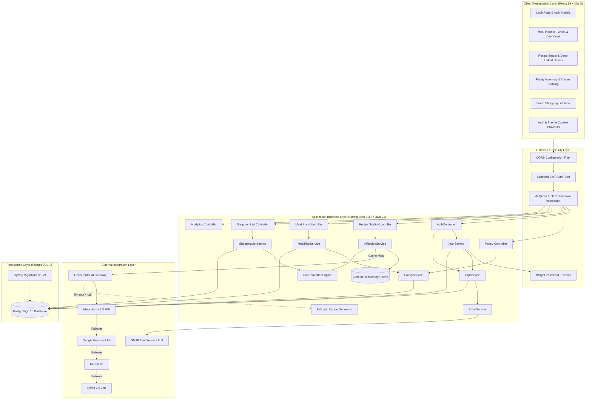
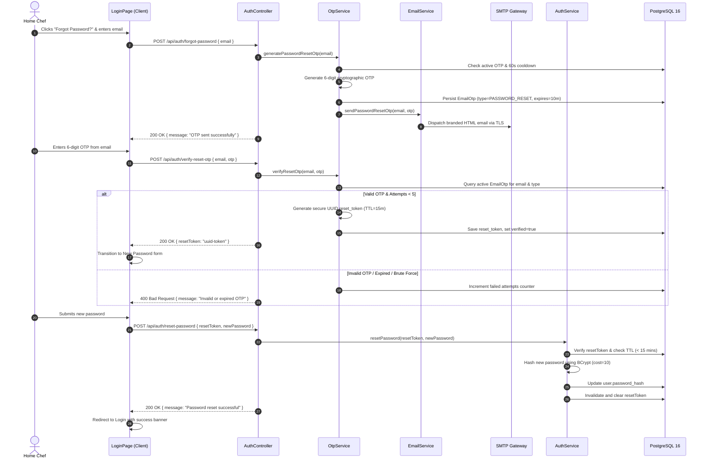
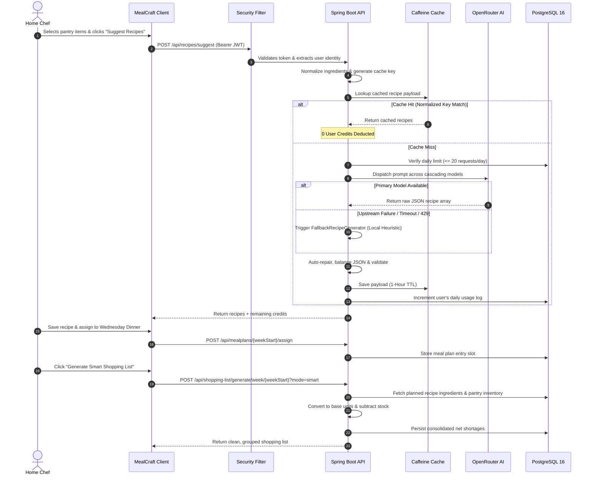
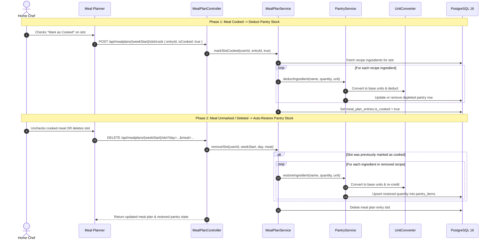
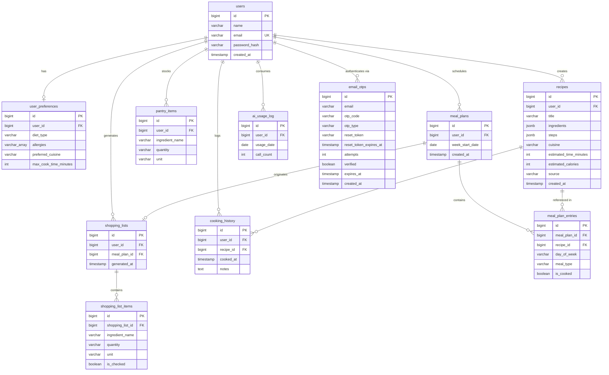

<div align="center">

# 🍳 MealCraft

### Intelligent Recipe Generation, 7-Day Meal Planning & Precision Grocery Logistics

*A production-grade, full-stack culinary operating system engineered with Java 21, Spring Boot 3.3, React 19, and PostgreSQL 16.*

---

[](https://spring.io/projects/spring-boot)
[](https://openjdk.org/)
[](https://react.dev/)
[](https://vitejs.dev/)
[](https://www.postgresql.org/)
[](https://flywaydb.org/)
[](#-security-identity--password-recovery)
[](https://junit.org/junit5/)
[](https://www.docker.com/)
[](https://opensource.org/licenses/MIT)

<p align="center">
  <a href="#-executive-summary">Executive Summary</a> •
  <a href="#-the-problem-vs-the-solution">Why MealCraft</a> •
  <a href="#-core-capabilities">Core Capabilities</a> •
  <a href="#-system-architecture">Architecture</a> •
  <a href="#-end-to-end-workflows">Workflows</a> •
  <a href="#-engineering-deep-dives">Deep Dives</a> •
  <a href="#-database-schema--entity-relationships">Database Schema</a> •
  <a href="#-rest-api-specification">API Reference</a> •
  <a href="#-quick-start--local-setup">Quick Start</a> •
  <a href="#-docker--docker-compose-deployment">Docker</a> •
  <a href="#-testing--quality-assurance">Testing</a> •
  <a href="#-configuration-reference">Configuration</a>
</p>

</div>

---

## 📌 Executive Summary

**MealCraft** is an intelligent, full-stack culinary platform that bridges the gap between disorganized home pantries, nutritional meal preparation, and grocery logistics. By synthesizing **multi-model generative artificial intelligence**, **deterministic unit conversion mathematics**, **enterprise-grade email OTP security**, and **modern glassmorphic interface design**, MealCraft empowers home cooks to:

1. **Transform Scattered Pantry Stock into Chef-Grade Recipes** without hallucinated ingredients or unstocked staples.
2. **Automate 7-Day Meal Scheduling** across Breakfast, Lunch, Dinner, and Snack slots using responsive Week and Day view interfaces.
3. **Consolidate Smart Shopping Lists** that calculate exact net mathematical shortages ($500\text{g} \text{ needed} - 200\text{g} \text{ in pantry} = 300\text{g} \text{ to buy}$) instead of naive string matching.
4. **Reconcile Inventory Bi-Directionally** by automatically deducting pantry stock upon cooking and auto-restoring ingredients if meals are unmarked or deleted.
5. **Protect User Accounts with Cryptographic OTPs & Ephemeral Reset Tokens** featuring brute-force lockout, rate-limit cooldowns, and branded transactional emails.
6. **Eliminate Operational AI Costs** through normalized key caching (0 credits consumed on cache hits) and multi-model fallback resiliency.

---

## ⚖️ The Problem vs. The Solution

| Challenge in Traditional Meal Apps | The MealCraft Solution |
| :--- | :--- |
| **Pantry Ingredients Ignored**: Apps suggest recipes requiring 15 new groceries without factoring in what already exists in your kitchen. | **Deterministic Inventory Matching**: AI generates recipes tailored strictly around existing pantry staples, isolating only true missing items. |
| **Naive Grocery Subtraction**: If a recipe needs 500g flour and you have 200g, traditional apps drop flour entirely or add another 500g. | **Base-Unit Mathematical Subtraction**: Converts all measurements (weight, volume, counts) to base metric units and computes the precise net difference. |
| **One-Way Inventory Tracking**: When meals are rescheduled or removed, deducted pantry stock is permanently lost. | **Bi-Directional Inventory Auto-Restoration**: Marking meals cooked deducts stock; unmarking or deleting scheduled meals automatically recalculates and refunds ingredients. |
| **Insecure Password Resets**: Weak password recovery flows rely on guessable security questions or static query parameters. | **Cryptographic Email OTP & Single-Use Tokens**: 6-digit OTP verification with 5-attempt brute-force lockout, 60s cooldowns, and ephemeral 15-minute reset tokens. |
| **High Latency & Fragile AI**: Upstream LLM rate limits or timeouts cause recipe generation to crash with generic 500 errors. | **Cascaded Multi-Model Fallback & Offline Engine**: Automatically rotates across 4 open LLMs (`Llama 3.3`, `Gemma 2`, `Mistral`, `Qwen 2.5`) with instant local heuristic fallback. |
| **Unpredictable AI Quotas**: Repetitive queries drain user credits rapidly. | **Zero-Credit Normalized Caching**: Identical or permuted pantry sets (`[Chicken, Rice]` vs `[Rice, Chicken]`) are served instantly from Caffeine cache at 0 credit cost. |

---

## 🚀 Core Capabilities

### 1. 🔐 Security, Identity & Password Recovery
* **Dual-Flow Email OTP Verification**: Supports secure 6-digit numeric OTP authentication for both user registration verification and self-service password reset flows.
* **Brute-Force & Rate-Limit Protection**:
  * **Exponential Lockout**: Automatically invalidates OTP codes after **5 consecutive failed attempts**.
  * **Cooldown Throttling**: Enforces a **60-second cooldown** between OTP dispatch requests (`app.otp.cooldown-seconds`).
  * **Hourly Ceiling**: Restricts requests to maximum 5 OTP dispatches per hour per email (`app.otp.max-requests-per-hour`).
* **Ephemeral Single-Use Reset Tokens**:
  * Upon valid reset OTP verification, an entropy-backed single-use `reset_token` is generated with a strict **15-minute Time-To-Live (TTL)**.
  * The password reset endpoint requires this token, preventing unauthorized password overrides.
  * Tokens are immediately invalidated upon successful password reset.
* **Branded Transactional HTML Emails**: Spring Boot `JavaMailSender` dispatches styled, responsive HTML emails with security warnings, expiration notices, and high-visibility OTP badges.

### 2. 🤖 Intelligent Multi-Model AI Recipe Studio
* **Dynamic Multi-LLM Cascading**: Communicates via OpenRouter with auto-failover across leading models:
  * Primary: `meta-llama/llama-3.3-70b-instruct:free`
  * Secondary: `google/gemma-2-9b-it:free`
  * Tertiary: `mistralai/mistral-7b-instruct:free`
  * Quaternary: `qwen/qwen-2.5-72b-instruct:free`
* **Deterministic Fallback Engine (`FallbackRecipeGenerator`)**: Guarantees 100% uptime. If upstream LLMs time out or encounter HTTP 429/503 limits, an internal culinary logic engine synthesizes balanced, chef-tested recipes immediately.
* **AST JSON Auto-Repair (`RecipeResponseParser`)**: Robust parser strips markdown fences, balances truncated JSON structures, and sanitizes ingredient strings before persisting.
* **Dedicated Recipe Studio & Deep Linking**: Direct URL routing (`/recipes/:id`) with nutritional breakdown, preparation checklist, and step-by-step cooking mode.

### 3. ⚖️ Base-Unit Conversion & Net-Shortage Arithmetic
* **Full Unit Conversion Hierarchy**:
  * **Weight**: Grams ($g$), Kilograms ($kg$), Ounces ($oz$), Pounds ($lb$).
  * **Volume**: Milliliters ($ml$), Liters ($l$), Cups ($240ml$), Tablespoons ($15ml$), Teaspoons ($5ml$).
  * **Discrete Counts**: Pieces, Cloves, Slices, Cans, Bunches, Pinches, Heads, Stalks, Sprigs.
* **Culinary Synonym Mapping**: Resolves 25+ common culinary aliases (`cilantro` $\rightarrow$ `coriander`, `capsicum` $\rightarrow$ `bell pepper`, `scallion` $\rightarrow$ `green onion`, `maida` $\rightarrow$ `all-purpose flour`).
* **Plural Stripping & Normalization**: Strips suffixes (`tomatoes` $\rightarrow$ `tomato`, `eggs` $\rightarrow$ `egg`) ensuring 100% deterministic inventory subtraction.

### 4. 🗓️ Responsive 7-Day Meal Planner & Bi-Directional Inventory
* **Dual View Modes**:
  * **7-Day Grid View**: Comprehensive weekly overview across Breakfast, Lunch, Dinner, and Snack.
  * **Mobile-Responsive Day View**: Focused daily schedule view with quick navigation and gesture-friendly controls.
* **Bi-Directional Inventory Auto-Restoration**:
  * Marking a meal slot as cooked deducts required ingredients from pantry inventory.
  * **Unmarking or deleting a cooked meal slot automatically restores deducted ingredients back into the pantry**, maintaining mathematically accurate inventory states.
* **One-Click Shopping List Sync**: Aggregates all ingredients scheduled for the week and calculates exact net shortages against current pantry stock.

### 5. 🧺 Canonical Master Ingredient Catalog
* **130+ Standardized Ingredients**: Curated database categorized into 8 culinary groups (Produce, Meat & Seafood, Dairy & Refrigerated, Pantry & Baking, Spices & Seasonings, Grains & Pasta, Canned Goods, Condiments & Oils).
* **Fuzzy Autocomplete**: Prevents typographical variations during pantry entry and recipe prompting.

### 6. 📊 Kitchen Analytics & Nutritional Telemetry
* **Weekly Calorie & Time Totals**: Visual distribution of planned vs. cooked calories, prep time per day, and busiest cooking days.
* **Cuisine Diversity Metrics**: Tracks top cuisine preferences and adherence over time.
* **Personal Cooking Journal**: Allows users to log personal chef notes and ratings upon completing recipes.

---

## 🏛️ System Architecture



---

## 🔄 End-to-End Workflows

### 1. 🔐 Secure Password Recovery & Reset Lifecycle



---

### 2. 🤖 AI Recipe Generation to Net-Shortage Shopping List



---

### 3. 🔄 Bi-Directional Inventory Depletion & Auto-Restoration



---

## 🔬 Engineering Deep Dives

### 1. Base-Unit Arithmetic & Net Shortage Formula
When a user generates a shopping list from a meal plan, the engine avoids naive text subtraction:

$$\Delta Q = Q_{\text{required}} - Q_{\text{pantry}}$$

1. **Extraction**: Parse numeric magnitude and unit string from both planned recipes and current pantry items.
2. **Category Identification**: Classify both units into `WEIGHT`, `VOLUME`, or `COUNT`.
3. **Base Normalization**:
   - If `WEIGHT`: Convert to grams ($g$) using $W_{g} = W \times \text{factor}$.
   - If `VOLUME`: Convert to milliliters ($ml$) using $V_{ml} = V \times \text{factor}$.
   - If `COUNT`: Standardize unit labels (`pieces`, `cloves`, `cans`).
4. **Subtraction**:
   $$\text{If } Q_{\text{pantry}} \ge Q_{\text{required}} \implies \text{Shortage} = 0 \text{ (Omit from list)}$$
   $$\text{If } Q_{\text{pantry}} < Q_{\text{required}} \implies \text{Add } (Q_{\text{required}} - Q_{\text{pantry}}) \text{ to shopping list}$$
5. **Display Formatting**: Automatically scales grams back to kilograms ($kg$) or milliliters back to liters ($l$) when quantity $\ge 1000$.

### 2. Cryptographic OTP Verification & Single-Use Reset Token Architecture
To guarantee security during sensitive password reset workflows:
1. **Entropy & Scoping**: The 6-digit OTP is generated using `SecureRandom` and bound strictly to an `OtpType` enum (`REGISTRATION` or `PASSWORD_RESET`).
2. **Brute Force Lockout**:
   $$N_{\text{failed}} \ge 5 \implies \text{Invalidate OTP immediately}$$
3. **Rate Limiting & Cooldown**: Consecutive generation requests for the same email must observe a minimum 60-second cooldown ($\Delta t_{\text{request}} \ge 60\text{s}$) with a hard cap of 5 requests per hour.
4. **Single-Use Ephemeral Reset Token**:
   * Successful OTP verification issues a high-entropy UUID reset token valid for **15 minutes**.
   * The client must present this `resetToken` along with `newPassword`.
   * Upon successful update, the token is permanently erased from the database, eliminating replay vulnerabilities.

### 3. Multi-Model LLM Resilience & Prompt Engineering
The prompt engine utilizes strict output enforcement:
* **System Prompt**: Enforces pure JSON output with zero conversational markdown framing.
* **Ingredient Anchoring**: Instructs the model to treat user pantry items as mandatory anchors and explicitly list missing necessities under a `missingIngredients` array with quantity and unit.
* **Fault-Tolerant JSON Parsing**: The `RecipeResponseParser` isolates the outermost JSON brackets `[...]`, strips leading markdown ticks, and repairs common syntax truncations.

### 4. Zero-Credit Caffeine In-Memory Cache
* **Normalized Key Generation**: Ingredients are lowercase-trimmed, synonym-mapped, sorted alphabetically, and concatenated with the target cuisine and max preparation time:
  $$\text{Key} = \text{MD5}(\text{sorted}(\text{ingredients}) + \text{cuisine} + \text{maxTime})$$
  Example: `[Salmon, Lemon, Asparagus]` and `[Asparagus, Salmon, Lemon]` produce the identical cache key.
* **Credit Exemption**: Queries hitting the cache bypass the database rate-limit increment, maximizing user quota efficiency.

---

## 🗄️ Database Schema & Entity Relationships

The database is managed with version-controlled **Flyway** migrations:
* `V1__initial_schema.sql`: Relational tables (`users`, `user_preferences`, `recipes`, `pantry_items`, `meal_plans`, `meal_plan_entries`, `shopping_lists`, `shopping_list_items`, `cooking_history`, `ai_usage_log`).
* `V2__add_is_cooked_to_meal_plan_entries.sql`: Extends meal planning with cooking completion tracking (`is_cooked` boolean).
* `V3__add_email_otp.sql`: Adds `email_otps` table for OTP code storage, attempt counts, and expiration management.
* `V4__add_password_reset.sql`: Adds `otp_type` enum (`REGISTRATION`, `PASSWORD_RESET`), `reset_token`, and `reset_token_expires_at` timestamp.



---

## 📡 REST API Specification

All secured endpoints require the header: `Authorization: Bearer <JWT_TOKEN>`.

### Endpoint Summary

| Module | Method | Endpoint | Description | Auth Required |
| :--- | :--- | :--- | :--- | :---: |
| **Auth** | `POST` | `/api/auth/register` | Register new user account | No |
| **Auth** | `POST` | `/api/auth/login` | Authenticate with credentials and obtain JWT | No |
| **Auth** | `POST` | `/api/auth/verify-otp` | Verify 6-digit registration OTP | No |
| **Auth** | `POST` | `/api/auth/resend-otp` | Resend registration OTP (subject to cooldown) | No |
| **Auth** | `POST` | `/api/auth/forgot-password` | Request password reset OTP via email | No |
| **Auth** | `POST` | `/api/auth/verify-reset-otp` | Verify reset OTP & receive ephemeral `resetToken` | No |
| **Auth** | `POST` | `/api/auth/reset-password` | Submit new password with valid `resetToken` | No |
| **Recipes** | `POST` | `/api/recipes/suggest` | Generate AI recipes from pantry ingredients | Yes |
| **Recipes** | `GET` | `/api/recipes/ai-credits` | Check remaining daily AI generation quota | Yes |
| **Recipes** | `GET` | `/api/recipes` | List saved recipes (filter by `cuisine`, `query`) | Yes |
| **Recipes** | `GET` | `/api/recipes/{id}` | Get detailed recipe by ID with instructions & nutrition | Yes |
| **Recipes** | `POST` | `/api/recipes` | Save recipe to user cookbook | Yes |
| **Recipes** | `DELETE`| `/api/recipes/{id}` | Delete recipe from cookbook | Yes |
| **Pantry** | `GET` | `/api/pantry` | Fetch all stocked pantry items | Yes |
| **Pantry** | `POST` | `/api/pantry` | Add or update quantity of pantry item | Yes |
| **Pantry** | `DELETE`| `/api/pantry/{id}` | Remove item from pantry | Yes |
| **Pantry** | `DELETE`| `/api/pantry` | Clear entire pantry inventory | Yes |
| **Planner** | `GET` | `/api/mealplans/{weekStart}` | Fetch 7-day meal plan for given Monday (`YYYY-MM-DD`) | Yes |
| **Planner** | `POST` | `/api/mealplans/{weekStart}/assign` | Assign recipe to slot (`dayOfWeek`, `mealType`, `recipeId`) | Yes |
| **Planner** | `POST` | `/api/mealplans/{weekStart}/slot/cook` | Toggle slot completion status (auto-deducts pantry) | Yes |
| **Planner** | `DELETE`| `/api/mealplans/{weekStart}/slot` | Remove recipe from slot (auto-restores pantry) | Yes |
| **Planner** | `DELETE`| `/api/mealplans/{weekStart}/clear` | Clear all planned meals for the week | Yes |
| **Shopping**| `POST` | `/api/shopping-list/generate/week/{weekStart}` | Generate smart shopping list by week start | Yes |
| **Shopping**| `POST` | `/api/shopping-list/generate/{mealPlanId}` | Generate shopping list from meal plan ID | Yes |
| **Shopping**| `GET` | `/api/shopping-list/plan/{mealPlanId}` | Get active shopping list for meal plan | Yes |
| **Shopping**| `GET` | `/api/shopping-list/{id}` | Get shopping list by ID | Yes |
| **Shopping**| `PATCH`| `/api/shopping-list/items/{itemId}/toggle` | Check/uncheck item on shopping list | Yes |
| **Shopping**| `POST` | `/api/shopping-list/{id}/items` | Add custom manual item to shopping list | Yes |
| **Analytics**| `GET` | `/api/analytics` | Get cooking stats, calories, and top cuisines | Yes |
| **Analytics**| `POST` | `/api/analytics/log/{recipeId}` | Log completed recipe to history with notes | Yes |
| **Prefs** | `GET` | `/api/preferences` | Retrieve user dietary restrictions & cook time | Yes |
| **Prefs** | `PUT` | `/api/preferences` | Update dietary restrictions & preferences | Yes |

---

### Sample Request & Response Payloads

#### 1. Request Password Reset OTP (`POST /api/auth/forgot-password`)
**Request Body:**
```json
{
  "email": "chef@mealcraft.app"
}
```
**Response (200 OK):**
```json
{
  "message": "Password reset OTP sent to your email"
}
```

#### 2. Verify Reset OTP & Obtain Reset Token (`POST /api/auth/verify-reset-otp`)
**Request Body:**
```json
{
  "email": "chef@mealcraft.app",
  "otp": "849201"
}
```
**Response (200 OK):**
```json
{
  "resetToken": "a1b2c3d4-e5f6-7890-abcd-ef1234567890"
}
```

#### 3. Submit New Password (`POST /api/auth/reset-password`)
**Request Body:**
```json
{
  "resetToken": "a1b2c3d4-e5f6-7890-abcd-ef1234567890",
  "newPassword": "NewSecurePassword123!"
}
```
**Response (200 OK):**
```json
{
  "message": "Password has been reset successfully"
}
```

#### 4. Generate Recipes from Ingredients (`POST /api/recipes/suggest`)
**Request Body:**
```json
{
  "ingredients": ["Chicken Breast", "Broccoli", "Garlic", "Soy Sauce"],
  "cuisine": "Asian",
  "maxTimeMinutes": 30
}
```
**Response (200 OK):**
```json
{
  "recipes": [
    {
      "title": "Garlic Soy Chicken & Broccoli Stir-Fry",
      "cuisine": "Asian",
      "estimatedTimeMinutes": 25,
      "estimatedCalories": 420,
      "usedIngredients": ["Chicken Breast", "Broccoli", "Garlic", "Soy Sauce"],
      "missingIngredients": [
        { "name": "Sesame Oil", "quantity": "1", "unit": "tbsp" },
        { "name": "Cornstarch", "quantity": "1", "unit": "tsp" }
      ],
      "steps": [
        "Slice chicken breast into thin bite-sized strips.",
        "Heat sesame oil in a wok or large skillet over high heat.",
        "Add minced garlic and sauté for 30 seconds until fragrant.",
        "Add chicken strips and stir-fry for 5-6 minutes until cooked through.",
        "Incorporate broccoli florets and soy sauce mixture; cover and steam for 3 minutes.",
        "Toss until sauce is glossy and serve immediately."
      ]
    }
  ],
  "remainingCredits": 19
}
```

---

## ⚡ Quick Start & Local Setup

### Prerequisites
* **Java 21 LTS** (Eclipse Temurin / OpenJDK)
* **Maven 3.9+**
* **Node.js 18+ & npm**
* **PostgreSQL 14+** running locally or via Docker
* *(Optional)* **SMTP credentials** (e.g. Gmail App Password) for OTP email dispatch

---

### Step 1: Clone Repository & Create `.env`

```bash
git clone https://github.com/jayeshahir09/MealCraft.git
cd MealCraft
cp .env.example .env
```

Configure your `.env` file:
```env
# Database Credentials
DB_URL=jdbc:postgresql://localhost:5432/mealplanner
DB_USERNAME=postgres
DB_PASSWORD=your_secure_password

# Authentication (256-bit secret)
JWT_SECRET=super_secret_jwt_key_that_is_at_least_32_characters_long

# AI Provider (Free key: https://openrouter.ai/keys)
OPENROUTER_API_KEY=sk-or-v1-your_openrouter_api_key

# Email / SMTP Configuration (Optional for development)
MAIL_HOST=smtp.gmail.com
MAIL_PORT=587
MAIL_USERNAME=your_email@gmail.com
MAIL_PASSWORD=your_app_password
MAIL_FROM=no-reply@mealcraft.app
```

Configure frontend environment:
```bash
cp frontend/.env.development frontend/.env
```
Ensure `frontend/.env` points to your backend:
```env
VITE_API_BASE_URL=http://localhost:8080/api
```

---

### Step 2: Initialize PostgreSQL Database

```sql
CREATE DATABASE mealplanner;
```
*(Flyway will automatically execute migrations `V1` through `V4` on backend startup).*

---

### Step 3: Launch the Backend

```bash
cd backend
mvn clean spring-boot:run
```
* Backend starts at `http://localhost:8080`.
* Flyway executes schema migrations automatically.

---

### Step 4: Launch the Frontend

```bash
cd frontend
npm install
npm run dev
```
* Client starts at `http://localhost:5173`.
* Navigate to `http://localhost:5173` to register an account and begin meal planning.

---

## 🐳 Docker & Docker Compose Deployment

Run the complete stack (PostgreSQL + Spring Boot Backend + React Frontend) with one command:

```yaml
# docker-compose.yml
version: '3.8'

services:
  postgres:
    image: postgres:16-alpine
    container_name: mealcraft-db
    environment:
      POSTGRES_DB: mealplanner
      POSTGRES_USER: postgres
      POSTGRES_PASSWORD: password
    ports:
      - "5432:5432"
    volumes:
      - mealcraft_pgdata:/var/lib/postgresql/data

  backend:
    build:
      context: ./backend
      dockerfile: Dockerfile
    container_name: mealcraft-api
    depends_on:
      - postgres
    environment:
      DB_URL: jdbc:postgresql://postgres:5432/mealplanner
      DB_USERNAME: postgres
      DB_PASSWORD: password
      JWT_SECRET: super_secure_256_bit_jwt_signing_secret_phrase
      OPENROUTER_API_KEY: ${OPENROUTER_API_KEY}
      MAIL_HOST: ${MAIL_HOST:-smtp.gmail.com}
      MAIL_PORT: ${MAIL_PORT:-587}
      MAIL_USERNAME: ${MAIL_USERNAME}
      MAIL_PASSWORD: ${MAIL_PASSWORD}
      AI_CALL_LIMIT: 20
      CORS_ALLOWED_ORIGINS: http://localhost:5173,http://localhost:3000
    ports:
      - "8080:8080"

volumes:
  mealcraft_pgdata:
```

Launch with:
```bash
docker-compose up -d
```

---

## 🧪 Testing & Quality Assurance

MealCraft includes an extensive **127-test suite** guaranteeing correctness across mathematical unit conversions, AI auto-repair parsers, caching semantics, transactional email OTPs, and REST controller contracts.

### Execute Backend Tests
```bash
cd backend
mvn test
```

### Test Suite Distribution

| Test Class | Category | Test Count | Scope |
| :--- | :--- | :---: | :--- |
| `UnitConverterTest` | Utility / Math | **31** | Grams, ml, cups, tbsp, oz, lbs, synonym aliases, plural stripping |
| `AuthControllerTest` | Web Layer / MockMvc | **12** | Input validation, OTP verification, password reset, login contracts |
| `AuthServiceTest` | Security / Service | **11** | Registration, BCrypt hashing, reset token verification, JWT claims |
| `PantryServiceTest` | Service Layer | **9** | Upsert logic, quantity updates, ownership validation |
| `MealPlanServiceTest` | Service Layer | **8** | Slot assignments, cooked toggles, auto-restoration on delete |
| `ShoppingListServiceTest` | Service Layer | **8** | Base-unit subtraction, aggregation, deduplication |
| `RecipeServiceTest` | Service Layer | **7** | Cookbook persistence, cuisine filters, search indexing |
| `ShoppingListControllerTest` | Web Layer / MockMvc | **6** | JSON serialization, route bindings, authentication filters |
| `RecipeControllerTest` | Web Layer / MockMvc | **6** | Endpoint validation, error handling, status code contracts |
| `MealPlanControllerTest` | Web Layer / MockMvc | **6** | Slot routes, clear endpoints, date formatting parameters |
| `AIRecipeServiceTest` | Service Layer | **5** | Cache hits (0 credit cost), rate-limit bounds, fallback execution |
| `RecipeResponseParserTest` | AI Parser | **5** | Truncated JSON repair, markdown stripping, schema validation |
| `PantryControllerTest` | Web Layer / MockMvc | **4** | CRUD endpoint contracts, authorization validation |
| `OtpServiceTest` | Security / Service | **2** | OTP generation, rate-limit cooldowns, brute-force lockout |
| `AnalyticsControllerTest` | Web Layer / MockMvc | **2** | History endpoint contracts and response payloads |
| `AnalyticsServiceTest` | Service Layer | **2** | Calorie calculations, cuisine ranking, cooking history |
| `PreferenceControllerTest` | Web Layer / MockMvc | **2** | Preference retrieval and update verification |
| `PreferenceServiceTest` | Service Layer | **2** | Dietary restriction updates, max prep time retention |
| **Total Passed** | **Full Suite** | **127** | **0 Failures, 0 Errors, 0 Skipped (100% Green)** |

### Run Frontend Static Analysis & Production Build
```bash
cd frontend
npm run lint
npm run build
```

---

## ⚙️ Configuration Reference

### Backend Options (`application.properties`)

| Environment Variable | Default Value | Description |
| :--- | :--- | :--- |
| `PORT` | `8080` | HTTP listening port for Spring Boot application |
| `DB_URL` | *Required* | JDBC connection string for PostgreSQL |
| `DB_USERNAME` | *Required* | Database user account name |
| `DB_PASSWORD` | *Required* | Database password |
| `JWT_SECRET` | *Required* | Secret key for signing and verifying HMAC-SHA256 JWTs |
| `JWT_EXPIRE` | `86400000` (24h) | Token expiration duration in milliseconds |
| `OPENROUTER_API_KEY` | *Optional* | API key for OpenRouter LLM requests |
| `MODEL_NAME` | `openrouter/free,...` | Ordered comma-separated list of fallback models |
| `TIMEOUT_SECONDS` | `35` | Timeout before failover to secondary model or local generator |
| `AI_CALL_LIMIT` | `20` | Daily limit of non-cached AI generations per user account |
| `MAIL_HOST` | `smtp.gmail.com` | SMTP host for sending verification and reset emails |
| `MAIL_PORT` | `587` | SMTP port (TLS enabled) |
| `MAIL_USERNAME` | *Optional* | SMTP username / sender account |
| `MAIL_PASSWORD` | *Optional* | SMTP password or app-specific password |
| `MAIL_FROM` | `no-reply@mealcraft.app` | Default sender display address in outgoing emails |
| `OTP_EXPIRATION_MINUTES`| `10` | Lifetime of generated OTP codes before expiration |
| `OTP_COOLDOWN_SECONDS` | `60` | Minimum wait time required between consecutive OTP resends |
| `OTP_MAX_ATTEMPTS` | `5` | Maximum failed attempts allowed before OTP lockout |
| `OTP_MAX_REQUESTS_PER_HOUR`| `5` | Maximum OTP dispatch requests per hour per email |
| `CORS_ALLOWED_ORIGINS` | `http://localhost:5173,...` | Permitted client web origins |

### Frontend Options (`.env`)

| Variable | Default Value | Description |
| :--- | :--- | :--- |
| `VITE_API_BASE_URL` | `http://localhost:8080/api` | Base URL pointing to Spring Boot backend API |

---

## ❓ Troubleshooting & FAQ

<details>
<summary><b>1. OpenRouter API returns 429 Rate Limit or 503 Service Unavailable</b></summary>
<br>
MealCraft includes automatic model failover. If all OpenRouter free tiers are saturated, <code>AIRecipeService</code> seamlessly delegates to <code>FallbackRecipeGenerator</code>, which generates balanced, chef-tested recipes locally based on your ingredients without failing the request.
</details>

<details>
<summary><b>2. Flyway Checksum Mismatch Error on Startup</b></summary>
<br>
If you modified an existing SQL migration script that was already applied, Flyway will fail for safety. Never modify applied migration files; instead, create a new sequential file (e.g., <code>V5__your_change.sql</code>) in <code>backend/src/main/resources/db/migration/</code>.
</details>

<details>
<summary><b>3. Email OTP Not Arriving in Development</b></summary>
<br>
If SMTP credentials are not configured in your environment, <code>EmailService</code> logs the generated OTP code directly to the Spring Boot console output (e.g. <code>[OTP DEBUG] Generated OTP for user@example.com: 123456</code>). Configure <code>MAIL_USERNAME</code> and <code>MAIL_PASSWORD</code> to enable live dispatch.
</details>

<details>
<summary><b>4. CORS Policy Blocking Frontend Requests</b></summary>
<br>
Ensure your frontend development port matches the allowed origins in <code>application.properties</code>. If your frontend runs on a port other than <code>5173</code>, set <code>CORS_ALLOWED_ORIGINS=http://localhost:YOUR_PORT</code> in your backend environment.
</details>

<details>
<summary><b>5. PostgreSQL Port 5432 Already in Use</b></summary>
<br>
If a local PostgreSQL instance is already bound to port 5432, you can map Docker PostgreSQL to another port (e.g. <code>5433:5432</code>) and update <code>DB_URL=jdbc:postgresql://localhost:5433/mealplanner</code>.
</details>

---

## 🤝 Contributing & Code Conventions

Contributions are welcome! Please follow these standards:
1. **Fork & Branch**: Create a feature branch (`git checkout -b feature/amazing-feature`).
2. **Code Style**:
   - Backend: Standard Google Java Style conventions, Lombok annotations where applicable.
   - Frontend: Modern functional React components with hooks, CSS custom properties.
3. **Tests**: Verify all 127 tests pass before submitting (`mvn test`). Add tests for new business logic.
4. **Commits**: Follow conventional commits (`feat:`, `fix:`, `docs:`, `refactor:`, `test:`).
5. **Pull Request**: Open a PR with a clear summary of changes and test evidence.

---

## 📄 License

This project is licensed under the [MIT License](LICENSE) — see the LICENSE file for details.

<div align="center">
  <sub>Crafted with passion for sustainable cooking, intelligent automation, and zero kitchen waste.</sub>
</div>
