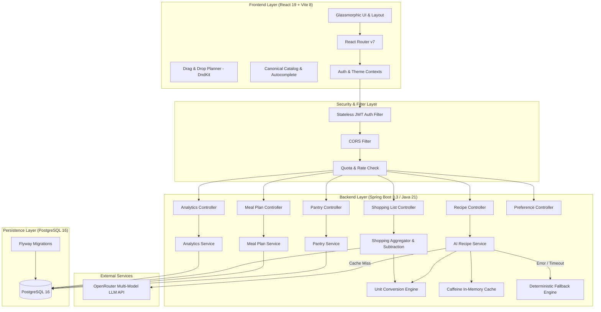
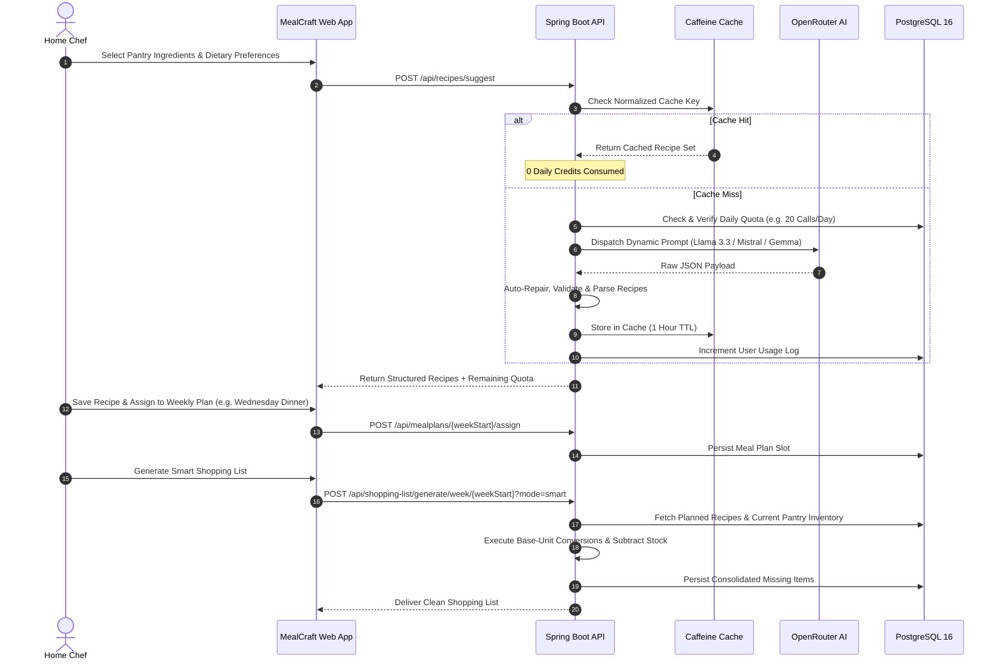

<div align="center">

# 🍳 MealCraft

**Intelligent Recipe Generation, 7-Day Meal Planning & Precision Grocery Logistics**

[](https://spring.io/projects/spring-boot)
[](https://openjdk.org/)
[](https://react.dev/)
[](https://vitejs.dev/)
[](https://www.postgresql.org/)
[](https://flywaydb.org/)
[](https://junit.org/junit5/)
[](https://www.docker.com/)
[](https://opensource.org/licenses/MIT)

<p align="center">
  <a href="#-key-features">Key Features</a> •
  <a href="#-system-architecture">Architecture</a> •
  <a href="#-workflow">Workflow</a> •
  <a href="#-tech-stack">Tech Stack</a> •
  <a href="#-project-structure">Project Structure</a> •
  <a href="#-getting-started">Getting Started</a> •
  <a href="#-rest-api-reference">API Reference</a> •
  <a href="#-testing--verification">Testing</a> •
  <a href="#-configuration-reference">Configuration</a>
</p>

</div>

---

## 📖 Overview

**MealCraft** is an intelligent, full-stack culinary platform engineered to eliminate food waste, simplify healthy eating, and streamline grocery shopping. By combining multi-model generative AI, deterministic unit conversion arithmetic, and a responsive glassmorphic UI, MealCraft turns whatever ingredients you have in your pantry into chef-grade recipes, auto-schedules them into a nutritional 7-day calendar, and generates precise, unit-subtracted shopping lists.

---

## ✨ Key Features

### 🤖 Multi-Model AI Recipe Studio
* **Multi-LLM Fallback Architecture**: Seamlessly calls OpenRouter with automatic cascaded failover across premier open models (`Llama 3.3 70B`, `Gemma 2 9B`, `Mistral 7B`, and `Qwen 2.5 72B`).
* **Deterministic Offline Generator**: If third-party AI services are unavailable or timeout, an internal culinary heuristic engine instantly delivers curated recipes without failing user requests.
* **Smart JSON Auto-Repair**: Robust parsing algorithms extract, sanitize, and auto-repair malformed LLM responses into structured recipe payloads.
* **Zero-Credit Normalized Caching**: Built-in Caffeine cache checks canonical ingredient keys—exact or equivalent pantry combinations consume **0** daily credits on cache hits.
* **Daily Quota Management**: Real-time quota endpoint (`/api/recipes/ai-credits`) with automatic daily log pruning resets limits cleanly each morning.

### ⚖️ Precision Base-Unit Conversion & Inventory Subtraction
* **Mathematical Unit Conversion**: Custom `UnitConverter` engine handles Weight (`kg`, `g`, `oz`, `lbs`), Volume (`l`, `ml`, `cups`, `tbsp`, `tsp`), and Discrete Counts (`pcs`, `cloves`, `slices`, `cans`).
* **Smart Pantry Subtraction**: Unlike naive name-matching engines that drop items regardless of quantity, MealCraft converts both requirements and stock into common base units (e.g. $500\text{g} \text{ needed} - 200\text{g} \text{ in pantry} = 300\text{g} \text{ on shopping list}$).

### 🗓️ Interactive 7-Day Drag-and-Drop Meal Planner
* **Weekly Visual Schedule**: Plan across Breakfast, Lunch, Dinner, and Snack slots for every day of the week.
* **Drag-and-Drop Organization**: Built with `@dnd-kit` for fluid reordering across days and slots.
* **Cooking & Adherence Tracking**: Mark meals as cooked to record nutritional metrics, update pantry inventory, and review adherence history.
* **One-Click Grocery Sync**: Automatically aggregate all ingredients from the active week's plan directly into a categorized grocery list.

### 🧺 Canonical Pantry & Master Catalog
* **130+ Curated Ingredients**: Preloaded database spanning 8 culinary categories with synonyms, default units, and emoji tags.
* **Fuzzy Autocomplete**: Real-time autocomplete prevents typographical fragmentation (`"tomatos"` vs `"tomato"`, `"cilantro"` vs `"coriander"`).
* **Instant Stock Management**: Add, update quantities, filter by category, or flush inventory in one click.

### 📊 Kitchen Analytics & Nutrition Tracking
* **Nutritional Insights**: Track planned vs. cooked calories, preparation time distribution, and top cuisine frequencies.
* **Weekly Cooking Log**: Record personal notes and cooking timestamps to track culinary habits over time.

### 🎨 Glassmorphic Interface & Modern Aesthetics
* **Theme Support**: High-contrast, accessibility-tested Dark and Light modes.
* **Responsive Layout**: Collapsible sidebar, mobile bottom navigation bar, dynamic toast alerts, and content-first typography cards (zero layout shifts from slow external photo CDNs).

---

## 🏛️ System Architecture



---

## 🔄 End-to-End Workflow



---

## 📦 Tech Stack

### Backend
| Technology | Version | Purpose |
| :--- | :--- | :--- |
| **Java** | 21 (LTS) | Modern language features (Records, Pattern Matching, Virtual Threads ready) |
| **Spring Boot** | 3.3.2 | Core framework (Web, Data JPA, Security, Cache, Validation) |
| **PostgreSQL** | 16 | Relational database storage |
| **Flyway** | 10.x | Version-controlled, reproducible database migrations |
| **JJWT** | 0.12.6 | Cryptographic stateless JWT token generation & validation |
| **Caffeine** | 3.1.8 | High-performance in-memory cache for normalized query results |
| **JUnit 5 / Mockito** | 5.x / 5.x | Unit, integration, and controller testing suite |
| **Lombok** | Latest | Boilerplate reduction for models and DTOs |

### Frontend
| Technology | Version | Purpose |
| :--- | :--- | :--- |
| **React** | 19.2 | Component architecture and state management |
| **Vite** | 8.2 | Lightning-fast development server and production bundler |
| **React Router** | 7.18 | Declarative client-side routing and protected routes |
| **@dnd-kit** | 6.3 / 10.0 | Accessible drag-and-drop meal planning interface |
| **Axios** | 1.19 | HTTP client with authentication interceptors |
| **Lucide React** | Latest | Modern, lightweight icon suite |
| **React Hot Toast** | 2.6 | Accessible, smooth UI notifications |
| **Oxlint** | 1.75 | High-speed Rust-based JavaScript linter |

---

## 📂 Project Structure

```text
MealCraft/
├── .env.example                     # Root environment variable template
├── README.md                        # Project documentation
├── backend/                         # Spring Boot application
│   ├── Dockerfile                   # Multi-stage production Docker build
│   ├── pom.xml                      # Maven dependencies & build configuration
│   └── src/
│       ├── main/
│       │   ├── java/com/mealplanner/
│       │   │   ├── MealPlannerApplication.java
│       │   │   ├── ai/              # LLM clients, prompt builder, JSON parser, fallback engine
│       │   │   ├── config/          # Cache config, security filter chain, CORS setup
│       │   │   ├── controller/      # REST API Controllers (Auth, Recipe, MealPlan, Pantry, etc.)
│       │   │   ├── dto/             # Data Transfer Objects & request/response payloads
│       │   │   ├── entity/          # JPA Entities (User, Recipe, MealPlan, PantryItem, etc.)
│       │   │   ├── exception/       # Global exception handlers & business errors
│       │   │   ├── repository/      # Spring Data JPA Repositories
│       │   │   ├── security/        # JWT utilities, user details service, auth filters
│       │   │   ├── service/         # Business logic layer
│       │   │   └── util/            # UnitConverter & mathematical utilities
│       │   └── resources/
│       │       ├── application.properties      # Main application configuration
│       │       ├── application-prod.properties # Production profile overrides
│       │       └── db/migration/               # Flyway SQL migration scripts (V1, V2)
│       └── test/                    # 111 Unit, Service, and Web Layer Tests
│           └── java/com/mealplanner/
│               ├── ai/              # Response parser tests
│               ├── controller/      # WebMvcMock controller endpoint tests
│               ├── service/         # Business logic & edge-case service tests
│               └── util/            # Mathematical unit converter tests
└── frontend/                        # React 19 + Vite Single Page Application
    ├── package.json                 # Node.js dependencies & scripts
    ├── vite.config.js               # Vite build configuration
    ├── index.html                   # HTML entry point
    └── src/
        ├── App.jsx                  # Main application routing & shell layout
        ├── index.css                # Glassmorphic design system tokens & styles
        ├── api/                     # Axios instance & API client modules
        ├── context/                 # AuthContext & ThemeContext
        ├── components/common/       # Header, Sidebar, BottomNav, Dropdowns, Modals
        ├── pages/                   # Dashboard, Recipe Studio, Meal Planner, Pantry, Analytics, etc.
        └── utils/                   # Ingredient database, date helpers, cuisine metadata
```

---

## 🚀 Getting Started

### Prerequisites
* **Java Development Kit (JDK) 21+** (`java -version`)
* **Apache Maven 3.9+** (`mvn -version`)
* **Node.js 18+ & npm** (`node -v` / `npm -v`)
* **PostgreSQL 14+** running locally or via Docker

---

### Step 1: Clone & Configure Environment

Clone the repository:
```bash
git clone https://github.com/jayeshahir09/MealCraft.git
cd MealCraft
```

Create your backend environment configuration:
```bash
# Copy root environment template
cp .env.example .env
```

Fill in your database and API credentials in `.env` (or configure your shell environment):
```env
# Database Credentials
DB_URL=jdbc:postgresql://localhost:5432/mealplanner
DB_USERNAME=postgres
DB_PASSWORD=your_secure_password

# Authentication (generate a secure 256-bit secret)
JWT_SECRET=your_super_secret_jwt_key_that_is_at_least_32_characters_long

# AI Engine (Get free API key at https://openrouter.ai/keys)
OPENROUTER_API_KEY=sk-or-v1-your_openrouter_api_key
```

Configure frontend environment:
```bash
# Inside frontend/
cp frontend/.env.development frontend/.env
```
Ensure `frontend/.env.development` points to your backend:
```env
VITE_API_BASE_URL=http://localhost:8080/api
```

---

### Step 2: Initialize Database
Create the PostgreSQL database (Flyway will automatically apply all schema migrations on startup):
```sql
CREATE DATABASE mealplanner;
```

---

### Step 3: Run the Backend

```bash
cd backend
mvn clean spring-boot:run
```
* Flyway executes versioned migrations (`V1__initial_schema.sql`, `V2__add_is_cooked...`).
* The server will start at `http://localhost:8080`.

---

### Step 4: Run the Frontend

In a separate terminal:
```bash
cd frontend
npm install
npm run dev
```
* The Vite dev server will start at `http://localhost:5173`.
* Open your browser and navigate to `http://localhost:5173`.

---

## 🐳 Docker Deployment

MealCraft backend includes a multi-stage Dockerfile that builds an optimized production runtime using `eclipse-temurin:21-jre-alpine`:

### Build Docker Image
```bash
cd backend
docker build -t mealcraft-backend:latest .
```

### Run Docker Container
```bash
docker run -d -p 8080:8080 \
  --name mealcraft-api \
  -e DB_URL="jdbc:postgresql://host.docker.internal:5432/mealplanner" \
  -e DB_USERNAME="postgres" \
  -e DB_PASSWORD="your_password" \
  -e JWT_SECRET="your_secure_jwt_secret" \
  -e OPENROUTER_API_KEY="your_openrouter_key" \
  -e AI_CALL_LIMIT="20" \
  mealcraft-backend:latest
```

---

## 🧪 Testing & Verification

MealCraft maintains a rigorous test suite comprising **111 tests** covering mathematical conversions, response parsing, rate limits, caching, and REST controllers.

### Run Backend Test Suite
```bash
cd backend
mvn test
```

#### Test Suite Breakdown:
```text
[INFO] -------------------------------------------------------
[INFO]  T E S T S
[INFO] -------------------------------------------------------
[INFO] Running com.mealplanner.ai.RecipeResponseParserTest         (5 tests)  --> PASSED
[INFO] Running com.mealplanner.controller.AnalyticsControllerTest  (2 tests)  --> PASSED
[INFO] Running com.mealplanner.controller.AuthControllerTest       (4 tests)  --> PASSED
[INFO] Running com.mealplanner.controller.MealPlanControllerTest   (6 tests)  --> PASSED
[INFO] Running com.mealplanner.controller.PantryControllerTest     (4 tests)  --> PASSED
[INFO] Running com.mealplanner.controller.PreferenceControllerTest (2 tests)  --> PASSED
[INFO] Running com.mealplanner.controller.RecipeControllerTest     (6 tests)  --> PASSED
[INFO] Running com.mealplanner.controller.ShoppingListControllerTest (6 tests) --> PASSED
[INFO] Running com.mealplanner.service.AIRecipeServiceTest         (5 tests)  --> PASSED
[INFO] Running com.mealplanner.service.AnalyticsServiceTest        (2 tests)  --> PASSED
[INFO] Running com.mealplanner.service.AuthServiceTest             (5 tests)  --> PASSED
[INFO] Running com.mealplanner.service.MealPlanServiceTest         (8 tests)  --> PASSED
[INFO] Running com.mealplanner.service.PantryServiceTest           (9 tests)  --> PASSED
[INFO] Running com.mealplanner.service.PreferenceServiceTest       (2 tests)  --> PASSED
[INFO] Running com.mealplanner.service.RecipeServiceTest           (7 tests)  --> PASSED
[INFO] Running com.mealplanner.service.ShoppingListServiceTest     (8 tests)  --> PASSED
[INFO] Running com.mealplanner.util.UnitConverterTest              (31 tests) --> PASSED
[INFO] 
[INFO] Results:
[INFO] Tests run: 111, Failures: 0, Errors: 0, Skipped: 0
[INFO] BUILD SUCCESS
```

### Run Frontend Linting
```bash
cd frontend
npm run lint
```

---

## 📡 REST API Reference

All secured endpoints require the HTTP Header: `Authorization: Bearer <JWT_TOKEN>`.

### 🔐 Authentication
| Method | Endpoint | Description | Auth Required |
| :--- | :--- | :--- | :---: |
| `POST` | `/api/auth/register` | Register new user account | No |
| `POST` | `/api/auth/login` | Authenticate credentials & return JWT | No |

### 🤖 AI Recipe Studio
| Method | Endpoint | Description | Auth Required |
| :--- | :--- | :--- | :---: |
| `POST` | `/api/recipes/suggest` | Generate recipe suggestions from ingredients | Yes |
| `GET` | `/api/recipes/ai-credits` | Retrieve user daily quota and remaining credits | Yes |
| `GET` | `/api/recipes` | List saved cookbook recipes (supports `?cuisine=&query=`) | Yes |
| `GET` | `/api/recipes/{id}` | Get detailed recipe by ID | Yes |
| `POST` | `/api/recipes` | Save an AI recipe into permanent cookbook | Yes |
| `DELETE`| `/api/recipes/{id}` | Delete recipe from cookbook | Yes |

### 🧺 Pantry Inventory
| Method | Endpoint | Description | Auth Required |
| :--- | :--- | :--- | :---: |
| `GET` | `/api/pantry` | List all current pantry items | Yes |
| `POST` | `/api/pantry` | Add new item or update existing item quantity | Yes |
| `DELETE`| `/api/pantry/{id}` | Remove specific item by ID | Yes |
| `DELETE`| `/api/pantry` | Clear entire pantry inventory | Yes |

### 🗓️ Weekly Meal Planner
| Method | Endpoint | Description | Auth Required |
| :--- | :--- | :--- | :---: |
| `GET` | `/api/mealplans/{weekStart}` | Fetch 7-day meal plan for given Monday (`YYYY-MM-DD`) | Yes |
| `POST` | `/api/mealplans/{weekStart}/assign` | Assign recipe to day slot (`dayOfWeek`, `mealType`, `recipeId`) | Yes |
| `POST` | `/api/mealplans/{weekStart}/slot/cook` | Toggle slot cooked state (`dayOfWeek`, `mealType`, `cooked`) | Yes |
| `DELETE`| `/api/mealplans/{weekStart}/slot` | Remove recipe from slot (`?dayOfWeek=&mealType=`) | Yes |
| `DELETE`| `/api/mealplans/{weekStart}/clear` | Clear all entries for specified week | Yes |

### 🛒 Smart Shopping List
| Method | Endpoint | Description | Auth Required |
| :--- | :--- | :--- | :---: |
| `POST` | `/api/shopping-list/generate/{mealPlanId}` | Build list from plan ID (`?mode=smart` or `simple`) | Yes |
| `POST` | `/api/shopping-list/generate/week/{weekStart}` | Build list directly by week start date | Yes |
| `GET` | `/api/shopping-list/plan/{mealPlanId}` | Retrieve existing shopping list for meal plan | Yes |
| `GET` | `/api/shopping-list/{id}` | Get shopping list by list ID | Yes |
| `PATCH`| `/api/shopping-list/items/{itemId}/toggle` | Toggle checked status of shopping list item | Yes |
| `POST` | `/api/shopping-list/{id}/items` | Add custom manual item to list | Yes |

### 📊 Kitchen Analytics
| Method | Endpoint | Description | Auth Required |
| :--- | :--- | :--- | :---: |
| `GET` | `/api/analytics` | Get cooking stats, top cuisines, and weekly totals | Yes |
| `POST` | `/api/analytics/log/{recipeId}` | Log completed recipe to cooking history with notes | Yes |

### ⚙️ User Preferences
| Method | Endpoint | Description | Auth Required |
| :--- | :--- | :--- | :---: |
| `GET` | `/api/preferences` | Retrieve user dietary restrictions & max prep time | Yes |
| `PUT` | `/api/preferences` | Update dietary restrictions, allergies & prep limits | Yes |

---

## ⚙️ Configuration Reference

### Backend (`application.properties`)

| Environment Variable | Default Value | Description |
| :--- | :--- | :--- |
| `PORT` | `8080` | Port on which the Spring Boot server listens |
| `DB_URL` | *Required* | JDBC connection URL (e.g. `jdbc:postgresql://localhost:5432/mealplanner`) |
| `DB_USERNAME` | *Required* | PostgreSQL user name |
| `DB_PASSWORD` | *Required* | PostgreSQL user password |
| `JWT_SECRET` | *Required* | 256-bit cryptographic signing secret |
| `JWT_EXPIRE` | `86400000` (24h) | JWT validity window in milliseconds |
| `OPENROUTER_API_KEY` | *Optional* | API Key for OpenRouter LLM services |
| `MODEL_NAME` | `openrouter/free,...` | Ordered comma-separated list of fallback models |
| `TIMEOUT_SECONDS` | `35` | Timeout for AI completion requests |
| `AI_CALL_LIMIT` | `20` | Daily limit of non-cached AI generations per user |
| `CORS_ALLOWED_ORIGINS` | `http://localhost:5173,...` | Comma-separated list of permitted CORS web origins |

### Frontend (`.env`)

| Variable | Default Value | Description |
| :--- | :--- | :--- |
| `VITE_API_BASE_URL` | `http://localhost:8080/api` | Base URL pointing to Spring Boot backend REST endpoints |

---

## 🔒 Security Best Practices

1. **Strict Credential Isolation**: AI API keys (`OPENROUTER_API_KEY`) and database passwords exist exclusively on the server and are never exposed to browser bundles.
2. **Deterministic Ownership Scoping**: Every database transaction and entity query verifies `user_id` ownership, guaranteeing complete multitenant isolation.
3. **Stateless JWT with BCrypt**: Passwords are cryptographically hashed using salted BCrypt, and all user sessions are validated via stateless signed JWT tokens.
4. **Input Sanitization & Boundary Limits**: Input parameters (such as ingredient lists and text fields) are strictly validated and bounded (max 50 ingredients, max 100 characters per item) to guard against prompt injection and memory exhaustion attacks.

---

## 🗺️ Roadmap & Planned Enhancements

- [ ] **OCR Receipt & Grocery Scanner**: Scan physical grocery receipts to instantly restock pantry inventory.
- [ ] **Barcode Lookup Integration**: Scan product UPC barcodes for auto-populating pantry items and nutritional metadata.
- [ ] **Social Cookbook Sharing**: Public sharing links for custom recipes and weekly curated meal plans.
- [ ] **Push & Calendar Reminders**: Web push notifications for daily prep reminders and defrost alerts.

---

## 📄 License

This project is licensed under the [MIT License](LICENSE) — see the LICENSE file for details.

<div align="center">
  <sub>Crafted with passion for sustainable cooking and effortless meal planning.</sub>
</div>
